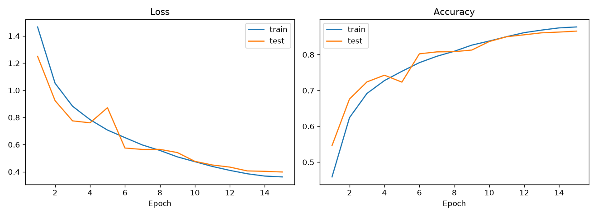

# KI-Webservice zur Bildklassifikation

Ein Convolutional Neural Network (CNN) in PyTorch, das Bilder aus dem CIFAR-10-Datensatz in 10 Klassen einordnet (Flugzeug, Auto, Vogel, Katze, Hirsch, Hund, Frosch, Pferd, Schiff, LKW). Ziel des Projekts ist es, das Modell als REST-API bereitzustellen, mit Docker zu containerisieren und über eine einfache Web-Oberfläche testbar zu machen.

> **Status:** in Arbeit. Training, Inferenz und Tests sind fertig, die API und die Web-Oberfläche folgen.

## Roadmap

- [x] CNN-Modell in PyTorch (3 Conv-Blöcke mit BatchNorm, Dropout)
- [x] Trainingsskript mit Data Augmentation, LR-Scheduler und Checkpointing
- [x] Inferenz-Skript für einzelne Bilder (Top-3-Vorhersagen)
- [x] Unit-Tests mit pytest
- [ ] REST-API mit FastAPI
- [ ] Docker-Container
- [ ] Web-Oberfläche (JavaScript) zum Hochladen und Klassifizieren von Bildern

## Ergebnisse

Nach 15 Epochen erreicht das Modell eine **Test-Genauigkeit von 86,6 %** auf den 10.000 Testbildern von CIFAR-10. Das Modell hat ca. 0,8 Mio. Parameter.



Trainings- und Test-Genauigkeit liegen nah beieinander (87,7 % vs. 86,6 %), das Modell überanpasst also kaum. In den ersten Epochen liegt die Test-Genauigkeit sogar über der Trainings-Genauigkeit, weil Data Augmentation und Dropout nur beim Training aktiv sind. Der Ausreißer in Epoche 5 glättet sich durch den Cosine-LR-Scheduler, der die Lernrate gegen Ende stetig senkt.

Die vollständigen Werte pro Epoche stehen in `models/metrics.json`.

## Projektstruktur

```
model.py           CNN-Architektur, Klassen und Normalisierungswerte
train.py           Training und Evaluation, speichert Checkpoint, Metriken und Lernkurven
predict.py         Klassifikation eines einzelnen Bildes
models/            trainiertes Modell, Metriken und Lernkurven
tests/             Unit-Tests (laufen ohne Datensatz-Download)
requirements.txt   Abhängigkeiten
```

## Installation

```bash
python3 -m venv .venv
source .venv/bin/activate        # Windows: .venv\Scripts\activate
pip install -r requirements.txt
```

## Training

```bash
python train.py                  # Standard: 15 Epochen
python train.py --epochs 30      # länger trainieren
```

CIFAR-10 wird beim ersten Start automatisch nach `data/` heruntergeladen. Danach liegen in `models/`:

- `cifar10_cnn.pt`: bester Checkpoint (nach Test-Genauigkeit)
- `metrics.json`: Verlauf von Loss und Accuracy pro Epoche
- `training_curves.png`: Lernkurven für Training und Test

Das Skript nutzt automatisch eine GPU (CUDA oder Apple Silicon), falls vorhanden.

## Vorhersage

Das trainierte Modell liegt bereits im Repository, die Vorhersage funktioniert also auch ohne eigenes Training:

```bash
python predict.py pfad/zum/bild.jpg
```

Ausgabe: die drei wahrscheinlichsten Klassen mit ihrer Wahrscheinlichkeit.

## Tests

```bash
pytest
```

Die Tests prüfen die Ausgabeform des Modells und ob ein Trainingsschritt den Loss auf einem kleinen Batch senkt.

## Technologien

Python, PyTorch, torchvision, Matplotlib, pytest. Geplant: FastAPI, Docker, JavaScript.
